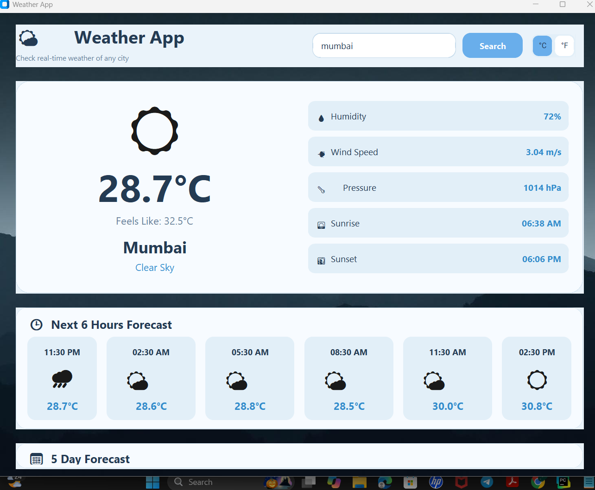

# 🌦️ Weather App – Python GUI Application

A modern and user-friendly Weather Application developed using Python and CustomTkinter. It provides real-time weather information and forecasts for cities around the world using the OpenWeatherMap API.

## ✨ Features

- 🌍 Search weather by city name
- 🌡️ Display current temperature
- 🔄 Celsius and Fahrenheit conversion
- 💧 Humidity information
- 💨 Wind speed and atmospheric pressure
- 🌅 Sunrise and sunset timings
- 🕒 6-hour weather forecast
- 📅 5-day weather forecast
- 🎨 Modern GUI with custom background and styling

## 🛠️ Technologies Used

- Python
- CustomTkinter
- OpenWeatherMap API
- Requests
- Python-dotenv
- Pillow

## 📁 Project Structure

```text
Weather_App/
│
├── main.py
├── gui.py
├── weather_api.py
├── config.py
├── .env
├── .gitignore
├── README.md
│
├── assets/
│   └── background.png
│
└── screenshots/
    └── weather_app.png
```

## 📸 Application Screenshot



## ⚙️ Installation and Setup

1. Clone the repository:

```bash
git clone https://github.com/PunitPatil1029/OIBSIP.git
```

2. Open the project folder.

3. Install required packages:

```bash
pip install customtkinter requests pillow python-dotenv
```

4. Create a `.env` file in the project folder and add your API key:

```env
OPENWEATHER_API_KEY=your_api_key_here
```

5. Run the application:

```bash
python main.py
```

## 🔐 API Configuration

This project uses the OpenWeatherMap API to retrieve real-time weather information.

Get your API key from [OpenWeatherMap](https://openweathermap.org/api).

Keep your API key private. Do not upload your `.env` file to GitHub.

## 👨‍💻 Developer

**Punit Patil**

GitHub: [PunitPatil1029](https://github.com/PunitPatil1029)

## 📌 Project Status

Completed – Developed as a Python Internship Project.

